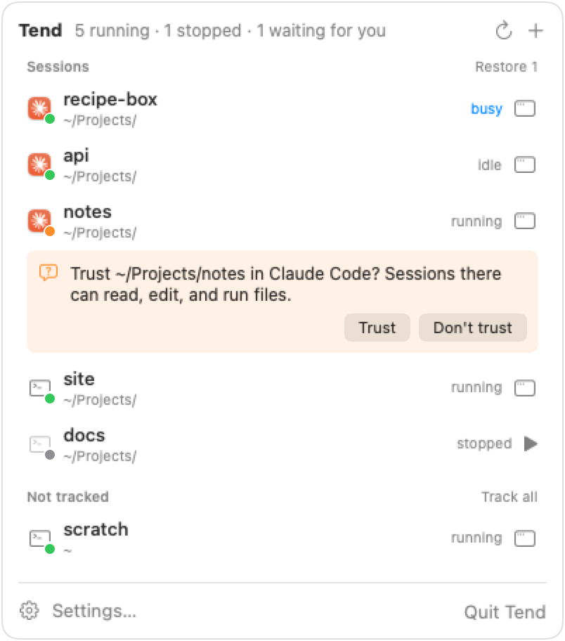

# Tend

Tend keeps a list of long-running terminal sessions on your Mac and brings
them back. Each session runs in tmux, so it keeps running after you close
your terminal or disconnect from ssh. After a restart, Tend starts your
sessions again, in the same folders, with the same commands.

Tend knows about the programs it runs. Claude Code support is built in: Tend
shows whether each Claude session is busy or idle, answers Claude's prompts
from the menu bar, and reconnects a restored session to the same conversation
instead of starting a new one. You can teach Tend about any other program.

Tend has two parts:

- `tend`, a command-line tool. It works over ssh.
- Tend.app, a menu bar app that shows your sessions and runs `tend` for you.

<p align="center">
  <picture>
    <source media="(prefers-color-scheme: dark)" srcset="docs/screenshot-dark.png">
    
  </picture>
</p>

## Who Tend is for

Suppose you run several Claude Code sessions with Remote Control, one per
project, so you can check on them and give them work from your phone or from
claude.ai/code. You start each one in a detached tmux session, so it keeps
running when you close the terminal. This works until your Mac restarts.
Then every session is gone, and you have to remember which folders had
sessions, start each one again, and find the conversations they were in.

Tend keeps that list for you. It restores every session after a restart and
reconnects each Claude session to its last conversation. The menu bar shows
which sessions are busy, which are idle, and which are waiting for you to
answer a question.

Tend isn't limited to Claude. Any long-running terminal program works, like a
development server or a script that keeps a connection open.

## Requirements

- macOS 14 or later, on Apple silicon or Intel.
- tmux. To install it, run `brew install tmux`.
- Python 3.8 or later. If you have Homebrew or the Xcode Command Line Tools,
  you already have it.

## Install

### From a release

1. Download `Tend-VERSION.dmg` from
   [Releases](https://github.com/Schaffernation/tend/releases), open it, and
   drag Tend to **Applications**.
2. Open Tend. It appears in the menu bar.
3. Click the Tend icon, click **Settings**, and turn on **Open Tend at
   login**. The first time Tend opens after your Mac starts, it restores your
   sessions. If you quit Tend or it crashes, your sessions keep running, and
   opening Tend again doesn't start or stop anything.
4. To use `tend` in a terminal, open **Settings**, and next to **tend**,
   click **Install**. Tend links `tend` into `~/.local/bin`, which needs to be
   on your `PATH`.

### From source

```
git clone https://github.com/Schaffernation/tend.git
cd tend
app/build.sh
ln -sfn "$PWD/bin/tend" ~/.local/bin/tend
```

`build.sh` installs the app in `/Applications` and opens it. To build without
installing, run `app/build.sh --no-install`. The app is then in `app/build`.

## Get started

To start a new Claude Code Remote Control session in the current folder, run:

```
tend new claude
```

To start any other command, put it after `--`:

```
tend new --dir ~/Projects/site -- npm run dev
```

If you already have tmux sessions running, track all of them:

```
tend snapshot
```

To list your sessions, including tmux sessions that Tend doesn't track yet,
run:

```
tend ls
```

After a restart, Tend.app restores your sessions when it opens. Without the
app, for example on a Mac you reach over ssh, run:

```
tend restore
```

For every command, run `tend --help`. To see where Tend keeps its files, run
`tend config`.

## Claude Code

When a session runs Claude Code, Tend does the following:

- **Shows its status.** The menu bar shows whether Claude is busy or idle.
- **Reconnects the conversation.** Restarting or restoring a Remote Control
  session reconnects its last conversation, if Remote Control still
  remembers it. Tend also records the conversations each session has run.
  To list them, run `tend history NAME`. To bring one back after Remote
  Control has forgotten it, run `tend resume NAME`.
- **Answers the trust prompt.** In a folder that you haven't trusted yet,
  Claude asks whether to trust it, and waits. Tend shows **Trust** and
  **Don't trust** buttons on the session's row. In a terminal, run
  `tend answer NAME yes`.
- **Starts fresh when you ask.** To start a new conversation instead of
  reconnecting, run `tend restart NAME --fresh`.

Tend reads files that Claude Code writes for its own use:
`~/.claude/sessions/*.json`, the trusted folders in `~/.claude.json`, and the
text of the trust prompt. Claude Code doesn't document these, so a Claude
Code update can change them, and Tend's Claude support can stop working until
Tend is updated. Tend only reads these files. It never changes them.

Tend is an independent project. It isn't made by or affiliated with
Anthropic.

## Add other programs

Tend recognizes programs from a list of apps. To add one, pass its name or
path:

```
tend apps add ngrok
```

In the app, open **Settings**, click **Apps**, and click **Add app**. An app
can also describe how to resume the program and which prompts it waits on.
The comment above `BUILTIN_APPS` in [`bin/tend`](bin/tend) documents every
field, and the built-in Claude app is a complete example.

## Set up a new folder

`tend new` can run a command once in a new folder before the session starts,
like cloning a repository:

```
tend new claude --dir ~/Projects/recipe-box --mkdir --recipe clone --input https://github.com/you/recipe-box.git
```

To save your own setup commands, use `tend recipes add`. To run a one-time
command without saving it, use `--setup CMD`.

## Open sessions with iTerm2's tmux integration

The open button attaches to a session in a new terminal window. To use iTerm2's
tmux integration instead, which shows each tmux window as a native iTerm2
window or tab, open **Settings**, click **Terminal**, and set **Attach with**
to **iTerm2 tmux integration (tmux -CC)**. Or run:

```
tend terminal --app iTerm --attach control
```

To run your own command, pass it to `--attach`. In the command, `{tmux}` is
the path to tmux, `{target}` is the session's tmux target, and `{name}` is
the session name:

```
tend terminal --attach '{tmux} -CC attach -d -t {target}'
```

## Run the tmux server in a launch agent

This step is optional. If you start sessions over ssh, programs in them can't
read your login keychain, so a program that keeps its credentials there,
like Claude Code, can't sign in. To avoid that, run the tmux
server in a launch agent, so it always starts in your login session.

1. Save the following as `~/Library/LaunchAgents/com.example.tmux-server.plist`:

   ```xml
   <?xml version="1.0" encoding="UTF-8"?>
   <!DOCTYPE plist PUBLIC "-//Apple//DTD PLIST 1.0//EN" "http://www.apple.com/DTDs/PropertyList-1.0.dtd">
   <plist version="1.0">
   <dict>
     <key>Label</key>
     <string>com.example.tmux-server</string>
     <key>ProgramArguments</key>
     <array>
       <string>/opt/homebrew/bin/tmux</string>
       <string>-D</string>
     </array>
     <key>EnvironmentVariables</key>
     <dict>
       <key>PATH</key>
       <string>/opt/homebrew/bin:/usr/local/bin:/usr/bin:/bin:/usr/sbin:/sbin</string>
     </dict>
     <key>RunAtLoad</key>
     <true/>
     <key>KeepAlive</key>
     <true/>
     <key>ProcessType</key>
     <string>Interactive</string>
   </dict>
   </plist>
   ```

   On an Intel Mac, change `/opt/homebrew/bin/tmux` to `/usr/local/bin/tmux`.

2. Load it:

   ```
   launchctl bootstrap gui/$(id -u) ~/Library/LaunchAgents/com.example.tmux-server.plist
   ```

3. In your Tend config file, set `tmux_launch_agent` to the agent's label:

   ```json
   "tmux_launch_agent": "com.example.tmux-server"
   ```

   If the server isn't running when Tend starts a session, Tend starts the
   agent first.

## Use Tend from Claude Code

[`skills/tend`](skills/tend/SKILL.md) is a Claude Code skill for starting and
managing sessions. Ask Claude for a new session, and it lists your project
folders, can create a new one, and starts the session with `tend new`. To
install it, run this command in the folder where you cloned Tend:

```
ln -sfn "$PWD/skills/tend" ~/.claude/skills/tend
```

## Other accounts on this Mac

Tend keeps sessions running in the account it runs in. If someone else on your
Mac has sessions too, like a family member who uses fast user switching,
install Tend in their account as well, with **Open Tend at login** on. After a
restart, their sessions come back once they log in.

macOS logs in only one account after a restart, so their account stays logged
out until someone logs it in. Your Tend can remind you. Open **Settings**,
click **Accounts**, and choose **Watch an account**. Or run:

```
tend accounts add USER
```

When a watched account isn't logged in, or is logged in without Tend running,
the menu bar icon shows a warning and the panel says what's wrong. If the
problem lasts a minute, Tend posts a notification. `tend ls` prints the same
warning.

Tend checks other accounts by looking for their processes: `loginwindow` means
the account is logged in, and `Tend` means its Tend is running. It doesn't
read anything in the other account.

## Files

Tend keeps its files in `~/.config/tend`:

- `sessions.json` holds your sessions, apps, recipes, and settings. You can
  edit it. To use a different file, set `TEND_CONFIG` to its path. If you
  used an earlier version of Tend, your file is named `services.json`, and
  Tend keeps using it.
- `.tend.lock` keeps two Tend commands from changing these files at once.
- `state.json` holds what Tend records for itself, like conversation history
  and when it last restored. Don't edit it.

Tend itself doesn't connect to the network. The programs and setup commands
it runs for you can.

## Build a release

To build a signed, notarized disk image, run `app/release.sh`. You need a
Developer ID Application certificate in your keychain. The script explains
the one-time notarization setup in its header.

## Contributing

See [CONTRIBUTING.md](CONTRIBUTING.md). For the design and the reasons behind
it, see [docs/intent.md](docs/intent.md). To report a security problem, see
[SECURITY.md](SECURITY.md).

## License

Tend is available under the [MIT License](LICENSE).
